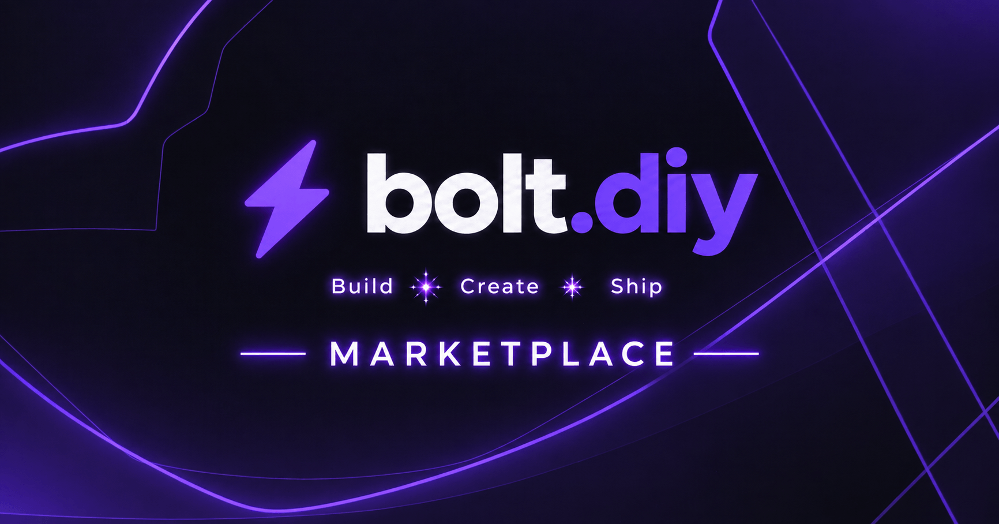

# bolt-marketplace

A plugin marketplace for the [bolt.diy](https://github.com/dustinwloring1988/bolt.diy) project.

## Overview

bolt-marketplace is a collection of plugins that extend the functionality of bolt.diy. Plugins are installed via the plugin system and can add tools, utilities, and integrations to your AI-assisted development environment.

## Plugin Structure

Each plugin follows a manifest-based approach with a `manifest.json` file and associated package files. Plugins are identified by their `id` in the format `name.publisher`.

## Demo Plugins

All demo packages currently use bolt.diy's supported `text-utils` plugin adapter. They expose text tools through the model; homepage and theme customization are not part of plugin API v1, so legacy settings that proposed those features are not included in the installable packages.

### bolt.demo

**ID**: `bolt.demo`

A marketplace demo for the supported text tools.

**Tools**:
- `count`: Count characters, words, and lines in text
- `transform`: Apply deterministic text transformations

### bolt.example2 and bolt.theme

These marketplace examples demonstrate the supported count and text transformation tools. The previous homepage and theme settings were prototypes and are not active capabilities.

### dustinwloring1988/simple

**ID**: `dustinwloring1988.simple`

A simple demonstration plugin for the bolt-marketplace plugin system.

**Tools**:
- `count`: Count characters, words, and lines in text

## Installation

Plugins can be installed through the bolt.diy plugin manager or by adding them to the marketplace catalog.

## License

See LICENSE file for details.
